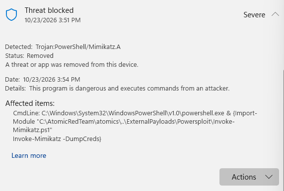
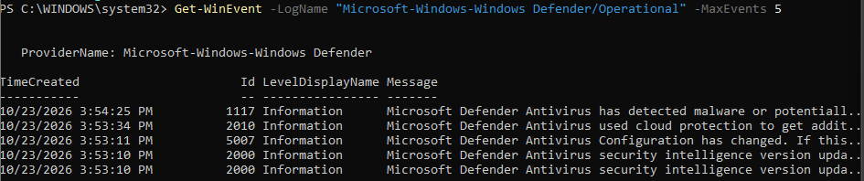

# T1059.001: PowerShell — Mimikatz (Prevented)

## Summary
Windows Defender blocked and removed Mimikatz before Atomic Red Team could execute it. Wazuh generated no alert, because the Windows Defender Operational log — which recorded the detection — is not currently a monitored source.

## Test Details
| Item | Detail |
|---|---|
| MITRE ATT&CK | T1059.001, PowerShell |
| Tool | Atomic Red Team, test 1 (Invoke-Mimikatz via PoshSploit) |
| Target | Windows-Victim |
| Date/time | 2026-10-23, ~15:51–15:54 |
| Command | `Invoke-AtomicTest T1059.001 -TestNumbers 1` |
| Result | PowerShell error: "Access is denied" — Defender removed the payload before it could run |

## What I Expected
Windows Defender should flag and block Mimikatz as known malware before the PowerShell script completes execution.

## Evidence
- Defender Protection History (detail view): 
- Defender Operational log entries: 
- Wazuh search (`mimikatz`, windows-victim, last 30 min): no results

| Field | Value |
|---|---|
| Detection name | Trojan:PowerShell/Mimikatz.A |
| Action | Removed |
| Detected command line | `powershell.exe & {Import-Module "...\Invoke-Mimikatz.ps1"; Invoke-Mimikatz -DumpCreds}` |
| Defender event ID | 1117 ("malware or potentially unwanted software detected") |
| Defender event time | 3:54:25 PM |
| Wazuh alert | None found |

## Detection Analysis
Defender intercepted the payload before Invoke-AtomicTest could launch it, producing a PowerShell "Access is denied" error rather than a completed test run. Protection History confirms the block, with the full malicious command line captured. The corresponding event (ID 1117) exists in the Windows Defender Operational log at 3:54:25 PM, one second after the "Removed" action shown in Protection History.

A search of Wazuh for this time window, on this agent, returned no results. This is not because no telemetry was generated — it's because the Wazuh agent's current `ossec.conf` does not collect the Windows Defender Operational log, only the Windows Security log. The detection happened entirely outside Wazuh's visibility.

## Severity Assessment
**High (as a potential blind spot).** The attack itself was neutralized, so impact was zero. But the detection gap is serious: a credential-dumping tool with "Severe" threat classification produced a complete local record and zero SIEM visibility. A SOC relying only on Wazuh alerts would have no indication this attack was ever attempted — it would learn about it only by checking endpoint tools directly, if at all.

## Detection Gap
Wazuh is not currently configured to collect the Windows Defender Operational event log. Endpoint-level preventions (which may be the *only* defense that worked against a given attack) are invisible to the SIEM as a result.

## Recommended Fix
Add the Defender Operational channel as an event source on the Windows agent. In the agent's `ossec.conf`:
\`\`\`xml
<localfile>
  <log_format>eventchannel</log_format>
  <location>Microsoft-Windows-Windows Defender/Operational</location>
</localfile>
\`\`\`
Restart the Wazuh agent service, then re-run this test to confirm Wazuh now alerts on event ID 1117 (or an equivalent Wazuh rule, once the default ruleset or a custom rule maps it).
