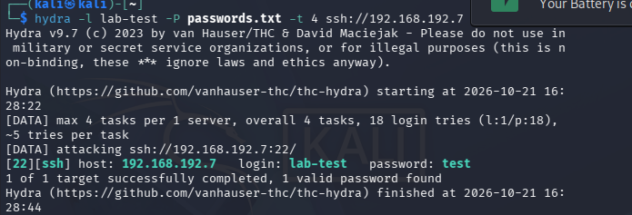

## Evidence
- Hydra output: 
- Wazuh threat hunting report: [PDF](../screenshots/T1110-threat-hunting-report.pdf)

| Field | Value |
|---|---|
| Primary rule | 5763 — sshd: brute force trying to get access to the system |
| Primary rule level | 10 |
| Correlation rule | 40112 — Multiple authentication failures followed by a success |
| Correlation rule level | 12 |
| Failed-login alerts | 21 (rule 5760) + 22 (rule 5557, PAM-level) |
| Successful login | Captured via rules 5501/5502 (session open/close) and tied to the failures by rule 40112 |
| Total alerts in window | 93 |
| Attack window | ~13:27–13:29 UTC |

## Detection Analysis
Wazuh detected the brute force at multiple layers: individual failed attempts (5760, 5557, 5503), a burst-pattern correlation (5551, 2502), a dedicated SSH brute-force rule (5763), and — most significantly — a level 12 correlation rule (40112) that specifically linked the failures to the eventual successful login. This last rule is the one that would actually get an analyst's attention in a real SOC queue, since a successful login alone looks identical to normal activity; it's only meaningful in the context of the failures that preceded it.

## Severity Assessment
**High.** Rule 40112 reached level 12, which is a meaningful severity in Wazuh's default scale and reflects a real compromise pattern: the brute force succeeded. In a non-lab environment, this sequence means an account is now compromised and needs immediate password rotation and session review.
