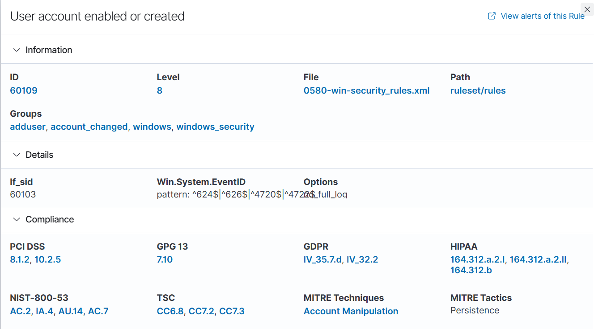

## What I Expected
Creating a local account should generate Windows Security event 4720 ("A user account was created") and trigger a Wazuh alert.

## Evidence
- Rule details: 
- Threat hunting report (filtered on event ID 4720): [PDF](../screenshots/T1136.001-threat-hunting-report.pdf)

| Field | Value |
|---|---|
| Rule ID | 60109 |
| Rule level | 8 |
| Rule description | User account enabled or created |
| Rule file | 0580-win-security_rules.xml (parent rule 60103) |
| Windows event ID | 4720 |
| Agent | windows-victim |
| MITRE tag in Wazuh | Account Manipulation (Persistence) |
| Created account | [targetUserName] |
| Created by | [subjectUserName] |

## Detection Analysis
Wazuh detected the account creation on the first attempt. The filtered threat hunting report shows exactly one alert (rule 60109, level 8) from the windows-victim agent, with no level 12+ alerts and no authentication events. This confirms the default Windows Security audit policy is enough to catch local account creation without Sysmon.

Two observations:
- Wazuh maps this rule to **Account Manipulation**, not T1136.001 (Create Account). Technique-based reporting would not match what the simulation actually did.
- Rule 60109 covers both account creation and account enabling, so the alert alone doesn't say which occurred. The event ID (4720) in the underlying log does.

## Severity Assessment
**Medium.** Level 8 is below Wazuh's high-priority threshold, which fits an event that is common in normal administration. An unexpected local account is still a classic persistence method, so it needs review. It would be higher severity if the creating account were unfamiliar, the activity happened outside a change window, or the new account were added to the Administrators group (event 4732).
